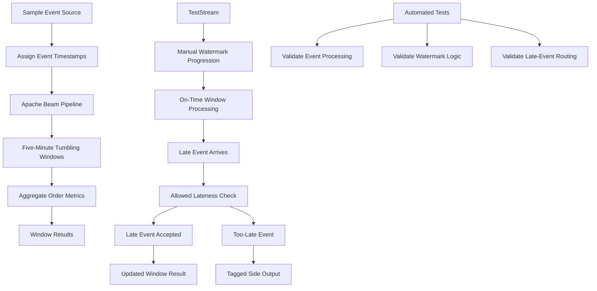
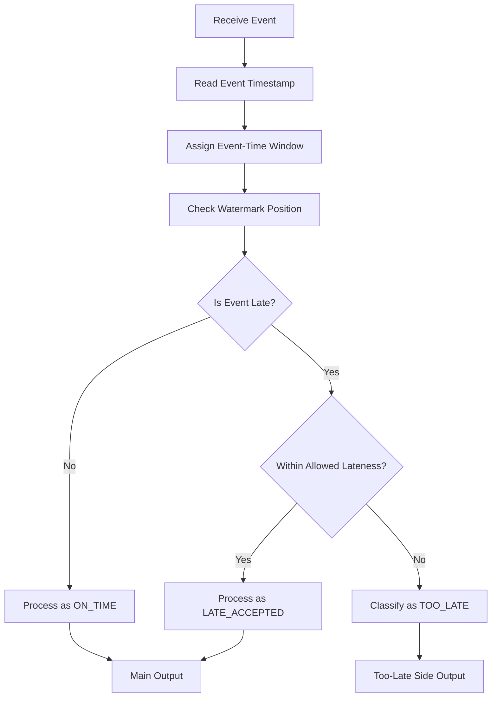

# Event-Time Windowing and Late-Event Handling Using Apache Beam

## 1. Project Overview

### Project Title

**Event-Time Windowing, Watermarks, Allowed Lateness, and Late-Event Routing Using Apache Beam**

### Introduction

In real-time data processing systems, events do not always arrive in the order in which they occur.

For example, consider an e-commerce application where customers place orders. Each order generates an event containing information such as:

- Event ID
- Customer ID
- Event type
- Order amount
- Event timestamp
- Arrival order

An order may occur at 10:03 AM but reach the processing system at 10:06 AM because of network delays, buffering, or other processing issues.

This creates a challenge: how should a streaming application process events that arrive late or out of order?

Apache Beam provides several concepts to handle this problem:

1. Event-time processing
2. Windowing
3. Watermarks
4. Allowed lateness
5. Triggers
6. Late-event handling
7. Side outputs

This project demonstrates these concepts using Python and Apache Beam.

It creates simulated streaming events, assigns event timestamps, groups events into fixed time windows, demonstrates watermark progression, processes late events, routes excessively late events separately, and validates the implementation using automated tests.

---

## 2. Project Objectives

The main objectives of this assignment are:

1. Understand the difference between event time and processing time.
2. Generate sample streaming events with timestamps.
3. Understand why events can arrive out of order.
4. Implement five-minute tumbling windows.
5. Understand how watermarks represent event-time progress.
6. Simulate watermark progression using Apache Beam TestStream.
7. Implement allowed lateness.
8. Demonstrate on-time and late event processing.
9. Generate late panes using event-time triggers.
10. Identify events that arrive beyond the allowed lateness period.
11. Route too-late events into a separate side output.
12. Create automated tests to validate event classification and routing.

---

## 3. Technology Stack

| Technology             | Version / Usage         | Purpose                                              |
| ---------------------- | ----------------------- | ---------------------------------------------------- |
| Python                 | 3.12                    | Programming language                                 |
| Apache Beam            | 2.77.0                  | Data processing framework                            |
| Apache Beam TestStream | Included with Beam      | Simulated streaming events and watermark progression |
| unittest               | Python standard library | Automated testing                                    |
| PowerShell             | Windows                 | Command-line execution                               |
| Visual Studio Code     | Editor                  | Project development                                  |
| Git                    | Optional                | Version control                                      |
| GitHub                 | Optional                | Repository hosting                                   |

### Why Apache Beam?

Apache Beam is a unified programming model for batch and streaming data processing.

It provides APIs for:

- Reading data
- Transforming data
- Assigning timestamps
- Grouping data into windows
- Combining data
- Managing late-arriving events
- Handling event-time triggers
- Producing multiple outputs

Apache Beam supports multiple execution runners, including DirectRunner, DataflowRunner, and FlinkRunner.

For this assignment, we use the DirectRunner to execute and test the pipeline locally.

---

# 4. Understanding the Core Concepts

Before understanding the implementation, it is important to understand the concepts used in this project.

## 4.1 Event

An event represents an occurrence in a system.

For example, when a customer places an order, the application generates an order-created event.

Example:

```json
{
  "event_id": "E1",
  "customer_id": "CUST101",
  "event_type": "ORDER_CREATED",
  "amount": 500,
  "event_time": "2026-11-17T10:01:00Z",
  "arrival_order": 1
}
```

This event contains information about the order and when it occurred.

## 4.2 Event Time

Event time is the actual time at which an event occurred.

Example:

An order was created at:

```text
10:01 AM
```

The event timestamp is 10:01 AM, regardless of when the processing system receives it.

Event time is important because business calculations should generally reflect when something happened, rather than when the system happened to process it.

## 4.3 Processing Time

Processing time is the time at which the processing system handles an event.

Example:

| Event | Event Time | Processing / Arrival Time |
| ----- | ---------- | ------------------------- |
| E1    | 10:01      | 10:01                     |
| E2    | 10:02      | 10:02                     |
| E3    | 10:04      | 10:04                     |
| E4    | 10:03      | 10:06                     |

E4 occurred at 10:03 but arrived at 10:06.

Therefore, E4 is an out-of-order, late-arriving event.

**Difference:**

- Event time: When the event happened.
- Processing time: When the system processed the event.

## 4.4 Out-of-Order Events

Out-of-order events are events that arrive in a different order from their actual occurrence.

Consider:

```text
Event E1: 10:01 AM
Event E2: 10:02 AM
Event E3: 10:04 AM
Event E4: 10:03 AM
```

The expected chronological order is:

```text
E1 → E2 → E4 → E3
```

But the arrival order is:

```text
E1 → E2 → E3 → E4
```

This can happen because of:

- Network delays
- Message broker delays
- Application buffering
- Distributed processing
- Retry mechanisms
- Unequal processing speeds

A streaming application must handle these events without incorrectly assigning them to the wrong time window.

## 4.5 Windowing

Windowing divides an unbounded stream of events into smaller groups based on time.

Instead of processing the entire stream as one collection, the application processes events within individual windows.

For this assignment, we use five-minute tumbling windows.

### Types of windows

| Window Type     | Explanation                                               | Example                    |
| --------------- | --------------------------------------------------------- | -------------------------- |
| Tumbling Window | Fixed-size, non-overlapping windows                       | 10:00–10:05, 10:05–10:10   |
| Sliding Window  | Fixed-size windows that overlap                           | 10:00–10:05, 10:01–10:06   |
| Session Window  | Groups events based on periods of activity and inactivity | Customer activity sessions |

### Tumbling Window Example

Our configuration:

```python
WINDOW_SIZE_SECONDS = 300
```

300 seconds = 5 minutes.

The resulting windows are:

```text
Window 1: 10:00 AM – 10:05 AM

Window 2: 10:05 AM – 10:10 AM
```

Events are assigned to windows using their event timestamps.

For example:

| Event | Event Time | Window      |
| ----- | ---------- | ----------- |
| E1    | 10:01      | 10:00–10:05 |
| E2    | 10:02      | 10:00–10:05 |
| E3    | 10:04      | 10:00–10:05 |
| E4    | 10:03      | 10:00–10:05 |
| E5    | 10:08      | 10:05–10:10 |

All four events E1, E2, E3, and E4 belong to the first window, even though E4 arrives later.

## 4.6 Watermark

A watermark is an estimate of how far event-time processing has progressed.

It helps a streaming system decide when it can consider a window complete enough to produce an on-time result.

For example:

```text
Window End: 10:05 AM

Watermark: 10:06 AM
```

The watermark has moved beyond the window end.

The system can now produce an on-time result for that window.

However, a watermark does not guarantee that no earlier event will ever arrive.

An event timestamped 10:03 AM may still arrive after the watermark has advanced to 10:06 AM.

### Important

A watermark is an estimate of event-time progress, not a guarantee that all earlier events have arrived.

## 4.7 Watermark Simulation

In this project, Apache Beam TestStream allows us to control watermark progression manually.

Example:

```python
stream = stream.advance_watermark_to(
    Timestamp.from_rfc3339(
        "2026-11-17T10:06:00Z"
    )
)
```

This moves the simulated watermark to 10:06 AM.

We can then introduce an event whose event timestamp is 10:03 AM.

This demonstrates how the system handles an event that arrives after the watermark has passed its window end.

### Heuristic Watermark

A heuristic watermark is an estimated watermark calculated using a rule.

For example:

```python
WATERMARK_DELAY_SECONDS = 5 * 60

def calculate_watermark(max_event_timestamp):
    return max_event_timestamp - WATERMARK_DELAY_SECONDS
```

Formula:

```text
Estimated Watermark =
Maximum Observed Event Timestamp - Allowed Delay
```

This is a simplified watermark calculation used for learning.

It is separate from the manually controlled watermark in TestStream.

## 4.8 Allowed Lateness

Allowed lateness defines how long a window can remain available to accept late-arriving events after its end.

In this project:

```python
ALLOWED_LATENESS_SECONDS = 120
```

120 seconds = 2 minutes.

Consider:

```text
Window Start:       10:00 AM
Window End:         10:05 AM
Allowed Lateness:   2 minutes
Cleanup Deadline:   10:07 AM
```

An event arriving after the window end but within the allowed lateness period can still be accepted.

An event arriving after the cleanup deadline is considered too late by our simulated classification logic.

### Example

| Event | Arrival Watermark | Classification      |
| ----- | ----------------- | ------------------- |
| E1    | 09:59             | On time             |
| E2    | 09:59             | On time             |
| E3    | 09:59             | On time             |
| E4    | 10:06             | Late but acceptable |
| E6    | 10:07:01          | Too late            |

The cleanup deadline is 10:07 AM.

The classification logic uses a strict greater-than comparison. Therefore, an arrival watermark exactly at 10:07 AM is not classified as too late.

## 4.9 Triggers

Triggers determine when a window should emit results.

For example, a window can emit an on-time result when the watermark passes its end.

It can also emit updated results when late events arrive.

In `late_events.py`, we use:

```python
trigger=beam.trigger.AfterWatermark(
    late=beam.trigger.AfterCount(1)
)
```

This means:

- Emit the on-time pane when the watermark passes the window end.
- Emit a late pane when at least one late element arrives after the on-time firing.

We also use:

```python
accumulation_mode=beam.trigger.AccumulationMode.ACCUMULATING
```

Accumulating mode means a subsequent pane includes previously observed values along with newly arrived late values.

For example:

| Pane         | Events         | Total Amount |
| ------------ | -------------- | -----------: |
| On-time pane | E1, E2, E3     |       ₹1,500 |
| Late pane    | E1, E2, E3, E4 |       ₹1,700 |

This is why the second pane contains the original events plus the late event.

## 4.10 Side Outputs

A side output is an additional output produced by a Beam transform.

It allows a pipeline to separate different categories of data.

For example:

- Accepted events go to the main output.
- Too-late events go to a separate output.

In this project, we use:

```python
TOO_LATE_TAG = "too_late"
```

And:

```python
beam.ParDo(
    ClassifyLateEvents()
).with_outputs(
    TOO_LATE_TAG,
    main="accepted"
)
```

The pipeline separates accepted events and too-late events.

This is useful in real-world applications because too-late events may need to be:

- Stored for auditing
- Investigated
- Reprocessed
- Sent to a dead-letter queue
- Used for reconciliation

**Important distinction:** Beam's native windowing can discard elements after a window's allowed lateness expires. The explicit side-output classification in this project occurs before that downstream windowing step, so the application can route those events instead of relying on Beam to automatically send dropped events to a side output.

---

# 5. Sample Dataset

The project uses five initial sample events.

| Event ID | Customer ID | Event Type    | Amount | Event Time | Arrival Order |
| -------- | ----------- | ------------- | -----: | ---------- | ------------: |
| E1       | CUST101     | ORDER_CREATED |   ₹500 | 10:01      |             1 |
| E2       | CUST102     | ORDER_CREATED |   ₹700 | 10:02      |             2 |
| E3       | CUST103     | ORDER_CREATED |   ₹300 | 10:04      |             3 |
| E4       | CUST104     | ORDER_CREATED |   ₹200 | 10:03      |             4 |
| E5       | CUST105     | ORDER_CREATED |   ₹900 | 10:08      |             5 |

E4 is intentionally out of order.

The actual chronological order is:

```text
E1 → E2 → E4 → E3 → E5
```

The arrival order is:

```text
E1 → E2 → E3 → E4 → E5
```

The late-routing demonstration introduces an additional event, E6, with an event timestamp of 10:04 AM and a simulated arrival watermark of 10:07:01 AM.

---

# 6. Project Architecture

The project contains separate modules for event generation, transformations, window processing, late-event processing, routing, and testing.

## 6.1 Architecture Diagram



## 6.2 Event Processing Flow



## 6.3 Pipeline Components

| Component           | File                         | Responsibility                                                   |
| ------------------- | ---------------------------- | ---------------------------------------------------------------- |
| Event Source        | `src/events.py`              | Generates sample events and parses timestamps                    |
| Transformations     | `src/transforms.py`          | Assigns event timestamps and prepares aggregation metrics        |
| Main Pipeline       | `src/pipeline.py`            | Runs five-minute tumbling-window aggregation                     |
| Late-Event Pipeline | `src/late_events.py`         | Demonstrates watermark-triggered on-time and late panes          |
| Late-Event Routing  | `src/late_routing.py`        | Classifies accepted and too-late events and routes them          |
| Pipeline Tests      | `tests/test_pipeline.py`     | Tests event generation, timestamp conversion, and event ordering |
| Watermark Tests     | `tests/test_watermarks.py`   | Tests simulated watermark calculations and TestStream processing |
| Routing Tests       | `tests/test_late_routing.py` | Tests on-time, late-accepted, and too-late classification        |

---

# 7. Complete Folder Structure

```text
event-time-window/
│
├── .venv/
│   └── Python virtual environment
│
├── data/
│   └── Sample or input data (if required)
│
├── docs/
│   └── Project documentation and diagrams
│
├── outputs/
│   └── Pipeline output files (if generated)
│
├── src/
│   ├── __init__.py
│   ├── events.py
│   ├── pipeline.py
│   ├── transforms.py
│   ├── late_events.py
│   └── late_routing.py
│
├── tests/
│   ├── __init__.py
│   ├── test_pipeline.py
│   ├── test_watermarks.py
│   └── test_late_routing.py
│
├── .gitignore
│
└── requirements.txt
```

### Folder Explanation

**.venv/**

Contains the isolated Python environment and installed dependencies.

**data/**

Reserved for sample datasets or external event data.

**docs/**

Contains project documentation, diagrams, and additional technical explanations.

**outputs/**

Reserved for generated pipeline outputs and reports. The current pipeline prints results to the terminal rather than saving them here.

**src/**

Contains the main application code.

**tests/**

Contains automated tests used to validate the application's functionality.

**requirements.txt**

Lists Python dependencies.

**.gitignore**

Prevents unnecessary files, such as virtual environments and Python cache files, from being committed to Git.

---

# 8. Project Setup From Scratch

The following setup instructions use Windows PowerShell.

## Step 1: Check Python Installation

Verify Python:

```powershell
python --version
```

The project was developed using Python 3.12.

## Step 2: Create Project Directory

```powershell
mkdir D:\event-time-window
```

Navigate to the directory:

```powershell
cd D:\event-time-window
```

## Step 3: Create a Virtual Environment

```powershell
python -m venv .venv
```

Activate it:

```powershell
.\.venv\Scripts\Activate.ps1
```

After activation, PowerShell should display:

```text
(.venv) PS D:\event-time-window>
```

## Step 4: Upgrade pip

```powershell
python -m pip install --upgrade pip
```

## Step 5: Create requirements.txt

Create a file named:

```text
requirements.txt
```

Add:

```text
apache-beam==2.77.0
```

## Step 6: Install Apache Beam

```powershell
pip install -r requirements.txt
```

## Step 7: Verify Apache Beam Installation

```powershell
python -c "import apache_beam as beam; print('Apache Beam version:', beam.__version__)"
```

Expected:

```text
Apache Beam version: 2.77.0
```

Verify TestStream:

```powershell
python -c "from apache_beam.testing.test_stream import TestStream; print('TestStream imported successfully')"
```

Expected:

```text
TestStream imported successfully
```

An optional warning about missing `apitools` or BigQuery client libraries may appear. These libraries are not required for the local DirectRunner examples in this project.

## Step 8: Create the Project Structure

Create the folders:

```powershell
mkdir src, tests, data, docs, outputs
```

Create the Python package files:

```powershell
New-Item src\__init__.py -ItemType File
New-Item tests\__init__.py -ItemType File
```

Create the application files:

```powershell
New-Item src\events.py -ItemType File
New-Item src\transforms.py -ItemType File
New-Item src\pipeline.py -ItemType File
New-Item src\late_events.py -ItemType File
New-Item src\late_routing.py -ItemType File
```

Create the test files:

```powershell
New-Item tests\test_pipeline.py -ItemType File
New-Item tests\test_watermarks.py -ItemType File
New-Item tests\test_late_routing.py -ItemType File
```

---

# 9. Implementation Steps

## Step 1: Create Sample Events

File:

```text
src/events.py
```

This module contains the sample event dataset.

It defines five events with:

- Event IDs
- Customer IDs
- Event types
- Amounts
- Event timestamps
- Arrival-order identifiers

It also contains helper functions to return sample events and parse ISO 8601 event timestamps.

The `get_sample_events()` function returns copies of the sample events so that changes made during processing do not modify the original dataset.

The `parse_event_time()` function converts the event timestamp string into a Python datetime object.

### Purpose

This module provides a consistent source of sample data for the pipeline and unit tests.

## Step 2: Create Data Transformations

File:

```text
src/transforms.py
```

This module contains the transformations used by the main pipeline.

### A. Assign Event Timestamp

The timestamp-assignment transformation uses the event's `event_time` field.

Apache Beam uses a timestamped element to associate the event with its actual event time.

Concept:

```text
Event → Parse Timestamp → Timestamped Event
```

### B. Convert to Order Metrics

The event is converted into a key-value structure:

```python
("all_orders", (amount, 1))
```

Here:

- `all_orders` is the aggregation key.
- `amount` represents the order amount.
- `1` represents one order.

### C. Aggregate Metrics

The aggregation function calculates:

```text
Total Amount = Sum of Order Amounts

Total Orders = Count of Events
```

### D. Format Window Results

The formatting transformation produces readable results containing:

- Window start time
- Window end time
- Total amount
- Total order count

## Step 3: Build the Main Pipeline

File:

```text
src/pipeline.py
```

This file implements the main event-time windowing pipeline.

### Processing Steps

1. Load the sample events.
2. Assign event timestamps.
3. Apply five-minute fixed windows.
4. Convert events into key-value metrics.
5. Aggregate order amounts and counts.
6. Format and print window results.

### Window Configuration

```python
FixedWindows(300)
```

This creates five-minute tumbling windows.

### Expected Output

```text
Window: 10:00–10:05

Total Amount: 1700
Total Orders: 4
```

```text
Window: 10:05–10:10

Total Amount: 900
Total Orders: 1
```

The first window contains E1, E2, E3, and E4.

The second window contains E5.

### Execute the Pipeline

```powershell
python -m src.pipeline
```

## Step 4: Implement Watermark Simulation

File:

```text
tests/test_watermarks.py
```

This module demonstrates event-time processing using Apache Beam TestStream.

TestStream allows the developer to:

- Add events with timestamps.
- Advance watermarks manually.
- Simulate late-arriving events.
- Observe window-processing behavior.

### Sample Watermark Progression

```text
Initial Events
      |
      v
Watermark: 09:59
      |
      v
Events E1, E2, E3
      |
      v
Advance Watermark to 10:06
      |
      v
Late Event E4 Arrives
      |
      v
Advance Watermark to 10:07
```

The test uses a five-minute delay formula as a simplified heuristic watermark calculation:

```python
WATERMARK_DELAY_SECONDS = 5 * 60
```

The calculation is:

```text
Estimated Watermark =
Maximum Event Timestamp - 5 Minutes
```

This is a learning example. TestStream's watermark is advanced explicitly and is not automatically calculated using this formula.

### Execute Watermark Tests

```powershell
python -m tests.test_watermarks
```

The test demonstrates that events can be added after the watermark has advanced.

## Step 5: Implement Late-Event Processing

File:

```text
src/late_events.py
```

This module demonstrates how Apache Beam handles late events using window triggers.

### Configuration

```python
FixedWindows(300)
```

Five-minute windows are created.

Allowed lateness:

```python
allowed_lateness=120
```

The window can retain late data for two minutes beyond its end, subject to the runner's window and trigger semantics.

### Trigger Configuration

```python
trigger=beam.trigger.AfterWatermark(
    late=beam.trigger.AfterCount(1)
)
```

This trigger produces:

- An on-time pane when the watermark passes the window end.
- A late pane when at least one late event arrives.

### Accumulation Mode

```python
beam.trigger.AccumulationMode.ACCUMULATING
```

Accumulating mode means late panes include previously observed data and the newly arrived late event.

### Sample Processing

Initial events:

```text
E1 = ₹500
E2 = ₹700
E3 = ₹300
```

Initial aggregation:

```text
Total = ₹1,500
Orders = 3
```

Late event:

```text
E4 = ₹200
```

Updated aggregation:

```text
Total = ₹1,700
Orders = 4
```

### Expected Output

```text
ON_TIME PANE:

Total Amount: 1500
Total Orders: 3
```

```text
LATE PANE:

Total Amount: 1700
Total Orders: 4
```

The late pane includes E1, E2, E3, and E4 because accumulating mode retains previous values.

### Execute

```powershell
python -m src.late_events
```

## Step 6: Implement Late-Event Routing

File:

```text
src/late_routing.py
```

This module implements explicit classification and routing of events.

It demonstrates three event categories:

1. On-time events
2. Late-but-acceptable events
3. Too-late events

### Configuration

```python
WINDOW_SIZE_SECONDS = 300
ALLOWED_LATENESS_SECONDS = 120

TOO_LATE_TAG = "too_late"
```

### Event Classification

The `ClassifyLateEvents` class extends:

```python
beam.DoFn
```

It uses:

```python
timestamp=beam.DoFn.TimestampParam
```

This provides the Beam element's event timestamp.

The classification logic calculates:

```text
Window Start =
Floor(Event Timestamp / Window Size) × Window Size
```

Then:

```text
Window End =
Window Start + 300 Seconds
```

And:

```text
Cleanup Deadline =
Window End + 120 Seconds
```

The simulated arrival-watermark metadata is compared with the calculated cleanup deadline.

### Classification Rules

| Condition                                                              | Classification |
| ---------------------------------------------------------------------- | -------------- |
| Arrival watermark is not beyond window end                             | ON_TIME        |
| Arrival watermark is beyond window end but not beyond cleanup deadline | LATE_ACCEPTED  |
| Arrival watermark is beyond cleanup deadline                           | TOO_LATE       |

### Main Output and Side Output

The pipeline uses:

```python
beam.ParDo(
    ClassifyLateEvents()
).with_outputs(
    TOO_LATE_TAG,
    main="accepted"
)
```

This produces two outputs:

**Accepted output**

Contains:

- On-time events
- Late-but-acceptable events

**Too-late output**

Contains events classified as `TOO_LATE`.

### Aggregation

Accepted events are assigned to five-minute windows with:

```python
beam.WindowInto(
    FixedWindows(WINDOW_SIZE_SECONDS),
    allowed_lateness=ALLOWED_LATENESS_SECONDS
)
```

They are then grouped using:

```python
beam.GroupByKey()
```

The formatting function calculates:

- Total amount
- Number of events
- Event IDs
- Event statuses

### Sample Output

On-time events:

```text
E1 = ₹500
E2 = ₹700
E3 = ₹300
```

Result:

```text
Total Amount: ₹1,500
Total Orders: 3
```

Late-but-acceptable event:

```text
E4 = ₹200
```

Result:

```text
Total Amount: ₹200
Total Orders: 1
```

Too-late event:

```text
E6 = ₹1,000
```

Result:

```text
TOO_LATE SIDE OUTPUT
```

### Important Implementation Detail

The routing classifier uses an explicitly supplied `arrival_watermark` field to make classification deterministic for this exercise.

It does not directly inspect Beam's internal current watermark.

Beam's `TimestampParam` supplies the event timestamp, not the watermark.

The earlier `late_events.py` module separately demonstrates Beam's actual watermark-triggered pane behavior.

The two modules demonstrate related but distinct mechanisms.

### Execute

```powershell
python -m src.late_routing
```

## Step 7: Create Automated Tests

The project uses Python's built-in `unittest` framework.

The tests validate event generation, timestamp conversion, out-of-order events, watermark calculations, and late-event classification.

### A. Pipeline Tests

File:

```text
tests/test_pipeline.py
```

Tests:

- Event generation
- Out-of-order events
- Timestamp conversion

### B. Watermark Tests

File:

```text
tests/test_watermarks.py
```

Tests:

- TestStream event processing
- Manual watermark progression
- Heuristic watermark calculation

### C. Late-Routing Tests

File:

```text
tests/test_late_routing.py
```

Four tests were implemented.

| Test   | Description                        | Expected Result      |
| ------ | ---------------------------------- | -------------------- |
| Test 1 | On-time event                      | ON_TIME              |
| Test 2 | Late event within allowed lateness | LATE_ACCEPTED        |
| Test 3 | Event beyond cleanup deadline      | TOO_LATE side output |
| Test 4 | Event exactly at cleanup deadline  | LATE_ACCEPTED        |

The fourth test checks the boundary condition of the cleanup deadline.

The classifier uses:

```python
arrival_watermark_seconds > cleanup_deadline
```

Therefore, an event exactly at the deadline is not classified as too late.

### Run Late-Routing Tests

```powershell
python -m unittest tests.test_late_routing -v
```

### Run Complete Test Suite

```powershell
python -m unittest discover -s tests -v
```

### Verified Test Results

The project successfully executed seven tests:

```text
test_event_at_cleanup_deadline_is_not_too_late ... ok

test_late_event_within_allowed_lateness ... ok

test_on_time_event_is_accepted ... ok

test_too_late_event_goes_to_side_output ... ok

test_event_generation ... ok

test_out_of_order_events ... ok

test_timestamp_conversion ... ok

----------------------------------------------------------------------
Ran 7 tests

OK
```

All seven tests passed.

---

# 10. Complete Event Processing Example

This section explains the complete scenario using the sample events.

## Initial Event Arrival

The first three events arrive:

| Event | Event Time | Amount |
| ----- | ---------- | -----: |
| E1    | 10:01      |   ₹500 |
| E2    | 10:02      |   ₹700 |
| E3    | 10:04      |   ₹300 |

All belong to the 10:00–10:05 window.

Total:

```text
₹500 + ₹700 + ₹300 = ₹1,500
```

## Watermark Advancement

The watermark advances to:

```text
10:06 AM
```

The first window has ended at 10:05 AM.

Beam can emit its on-time result.

## Late Event Arrival

Now E4 arrives:

```text
Event Time: 10:03 AM
Arrival Watermark: 10:06 AM
Amount: ₹200
```

The event belongs to the 10:00–10:05 window.

The window's cleanup deadline is 10:07 AM.

Therefore, E4 is classified as:

```text
LATE_ACCEPTED
```

## Too-Late Event Arrival

The watermark advances to:

```text
10:07:01 AM
```

Now E6 arrives:

```text
Event Time: 10:04 AM
Arrival Watermark: 10:07:01 AM
Amount: ₹1,000
```

Its cleanup deadline was 10:07 AM.

Since the arrival watermark is beyond the cleanup deadline, the routing classifier produces:

```text
TOO_LATE
```

E6 is sent to the separate side output.

---

# 11. Final Project Results

The following results were observed during implementation.

## Main Window Aggregation

| Window      | Events         | Total Orders | Total Amount |
| ----------- | -------------- | -----------: | -----------: |
| 10:00–10:05 | E1, E2, E3, E4 |            4 |       ₹1,700 |
| 10:05–10:10 | E5             |            1 |         ₹900 |

## Late-Event Processing

| Processing Stage                    | Events         | Total Amount | Status   |
| ----------------------------------- | -------------- | -----------: | -------- |
| On-time pane                        | E1, E2, E3     |       ₹1,500 | ON_TIME  |
| Late pane                           | E1, E2, E3, E4 |       ₹1,700 | LATE     |
| Routing aggregation: on-time events | E1, E2, E3     |       ₹1,500 | Accepted |
| Routing aggregation: late event     | E4             |         ₹200 | Accepted |
| Side output                         | E6             |       ₹1,000 | TOO_LATE |

The late pane and routing aggregation are separate demonstrations. The late pane is cumulative, whereas the routing aggregation displays the on-time and late event groups separately in the observed output.

## Automated Testing

| Metric         |   Result |
| -------------- | -------: |
| Total tests    |        7 |
| Passed         |        7 |
| Failed         |        0 |
| Test framework | unittest |

**Overall result:** The implemented pipeline and its seven automated tests executed successfully.

---

# 12. Heuristic Watermarks vs. Perfect Watermarks

A watermark is an estimate of how far event-time processing has progressed.

A heuristic watermark uses an estimated delay to determine which events are likely to have arrived.

For example:

```text
Estimated Watermark =
Maximum Observed Event Timestamp - 5 Minutes
```

This approach is simple and useful in streaming applications where exact knowledge of future event arrivals is impossible.

A perfect watermark would indicate that no earlier event will ever arrive. However, a distributed streaming system generally cannot know this with certainty while the stream is still active.

Network delays, retries, message buffering, and disconnected producers can cause older events to arrive unexpectedly.

### Comparison

| Feature                | Heuristic Watermark                       | Perfect Watermark                                         |
| ---------------------- | ----------------------------------------- | --------------------------------------------------------- |
| Meaning                | Estimated event-time progress             | Guaranteed event-time completeness                        |
| Practicality           | Commonly used                             | Generally impossible to guarantee for an unbounded stream |
| Late events            | Possible                                  | None before the declared completeness point               |
| Processing             | Can emit results before all events arrive | Would need certainty that no earlier event remains        |
| Trade-off              | Balances latency and completeness         | Could require waiting indefinitely                        |
| Real-world suitability | Practical                                 | Not generally achievable for ongoing distributed streams  |

### Summary: 200-Word Explanation

A heuristic watermark is an estimated measure of how far event-time processing has progressed in a streaming system. It is commonly calculated using observed event timestamps and an expected delay. For example, a system may subtract five minutes from the maximum observed event timestamp to estimate the watermark. This allows the system to produce window results without waiting indefinitely for every possible event.

However, heuristic watermarks cannot guarantee that all earlier events have arrived. Network delays, message retries, buffering, and distributed processing can cause older events to arrive after the watermark has advanced. These events are known as late-arriving events.

A perfect watermark would guarantee that no event with an earlier timestamp will ever arrive. Although this sounds ideal, it is generally impossible to guarantee for an unbounded distributed stream because the system cannot know whether a delayed event is still in transit.

Therefore, practical streaming systems use heuristic watermarks and configure allowed lateness to handle delayed events. This creates a balance between processing latency and data completeness. If the allowed lateness period expires, the system may discard the event or route it to a separate output for auditing and reprocessing.

In this project, Apache Beam TestStream demonstrates manual watermark progression, while a separate simulated arrival-watermark field demonstrates deterministic late-event classification.

---

# 13. Real-World Applications

The concepts implemented in this project are useful in several industries.

| Industry           | Application            | Example                        |
| ------------------ | ---------------------- | ------------------------------ |
| E-commerce         | Order analytics        | Late-arriving order events     |
| Banking            | Transaction monitoring | Delayed financial transactions |
| Financial Markets  | Trade processing       | Out-of-order market events     |
| Healthcare         | Patient monitoring     | Delayed device readings        |
| IoT                | Sensor analytics       | Network-delayed sensor data    |
| Logistics          | Shipment tracking      | Delayed delivery updates       |
| Telecommunications | Network monitoring     | Delayed network events         |
| Fraud Detection    | Real-time detection    | Late transaction signals       |

### Example: Financial Transaction Processing

Suppose a banking application receives transaction events.

A transaction occurs at 10:03 AM but reaches the analytics system at 10:06 AM.

If the application has already calculated the 10:00–10:05 window, the transaction may still need to be included in the results.

Using event-time processing, watermarks, and allowed lateness, the system can handle the delayed transaction appropriately.

This helps maintain more accurate reporting and analytics.

---

# 14. Known Limitations

This project is an educational demonstration and has several limitations.

### 1. Simulated Event Source

The events are generated using sample data and Apache Beam TestStream.

The project does not connect to a live message broker such as Apache Kafka or Google Cloud Pub/Sub.

### 2. Manual Watermark Progression

TestStream advances watermarks explicitly.

The project does not implement a production watermark-generation strategy.

### 3. Simulated Arrival-Watermark Classification

The `late_routing.py` classifier uses an `arrival_watermark` field supplied with each event.

This makes the classification deterministic but does not read Beam's actual internal watermark.

### 4. Local Execution

The project uses the local DirectRunner.

It does not demonstrate distributed execution using Dataflow, Flink, or Spark.

### 5. No Persistent Storage

The pipeline prints results to the terminal.

It does not persist accepted or too-late events to a database or cloud storage.

### 6. No Dead-Letter Queue

Too-late events are routed to a Beam side output but are not published to an external dead-letter queue.

### 7. Limited Testing Dataset

The project uses a small sample dataset for learning and verification.

It has not been benchmarked against high-volume production workloads.

---

# 15. Future Improvements

The project can be extended with the following features:

1. Integrate Apache Kafka as a real-time event source.
2. Integrate Google Cloud Pub/Sub.
3. Implement a production-oriented streaming pipeline.
4. Store accepted events in PostgreSQL.
5. Store too-late events in a dead-letter queue.
6. Export results to Parquet files.
7. Build a real-time dashboard using Grafana or Power BI.
8. Implement event deduplication.
9. Add event validation and schema enforcement.
10. Deploy the pipeline to Google Cloud Dataflow.
11. Monitor pipeline throughput and processing latency.
12. Add integration tests for the complete streaming pipeline.

---

# 16. Complete Execution Guide

After setting up the project and activating the virtual environment, execute the following commands from the project root.

### Execute the main windowing pipeline

```powershell
python -m src.pipeline
```

### Execute watermark demonstration

```powershell
python -m tests.test_watermarks
```

### Execute late-event processing

```powershell
python -m src.late_events
```

### Execute late-event routing

```powershell
python -m src.late_routing
```

### Execute late-routing tests

```powershell
python -m unittest tests.test_late_routing -v
```

### Execute all automated tests

```powershell
python -m unittest discover -s tests -v
```

---

# 17. Dependencies

The project requires:

```text
apache-beam==2.77.0
```

Install dependencies using:

```powershell
pip install -r requirements.txt
```

---

# 18. Git and GitHub Setup

To initialize the repository:

```powershell
git init
```

Check the files:

```powershell
git status
```

Add the project files:

```powershell
git add .
```

Commit:

```powershell
git commit -m "Build event-time windowing and late-event routing pipeline"
```

Create a GitHub repository and connect it:

```powershell
git remote add origin https://github.com/Ashu11122000/event-time-window.git
```

Push:

```powershell
git branch -M main
git push -u origin main
```

Ensure `.venv/` is excluded from Git.

---

# 19. Final Project Summary

This project demonstrates the fundamentals of event-time stream processing using Python and Apache Beam.

It starts with sample e-commerce order events containing event timestamps and arrival-order information. The events are assigned event timestamps and grouped into five-minute tumbling windows to calculate order totals and counts.

Apache Beam TestStream is used to simulate streaming behavior and manually advance watermarks. The project demonstrates how a watermark can pass a window's end while an earlier event is still delayed.

Allowed lateness is configured to two minutes. The late-event pipeline uses watermark-based triggers and accumulating panes to demonstrate how late events can update an earlier window result.

A separate late-event routing pipeline classifies events as on time, late but acceptable, or too late. Accepted events are processed through the main output, while events beyond the simulated cleanup deadline are routed through a tagged side output.

Finally, automated unit tests validate event generation, timestamp conversion, event ordering, late-event classification, and boundary conditions.

All seven executed automated tests passed.

The project provides a practical foundation for understanding real-time data processing, event-time windowing, watermark progression, late-arriving events, and Apache Beam streaming concepts.

---

# 20. Conclusion

Event-time processing is an important concept in modern data engineering because real-world events do not always arrive in chronological order.

This assignment demonstrates how streaming systems can organize events using event timestamps, process them through time-based windows, track progress using watermarks, and handle delayed events using allowed lateness.

It also demonstrates how to separate excessively late events using side outputs and how to validate the implementation through automated tests.

The knowledge gained from this project can be applied to larger data engineering systems involving Apache Kafka, Apache Beam, Google Cloud Dataflow, Apache Flink, real-time analytics, and distributed event-processing architectures.

**Project Status: Core implementation and seven automated tests successfully completed.**
